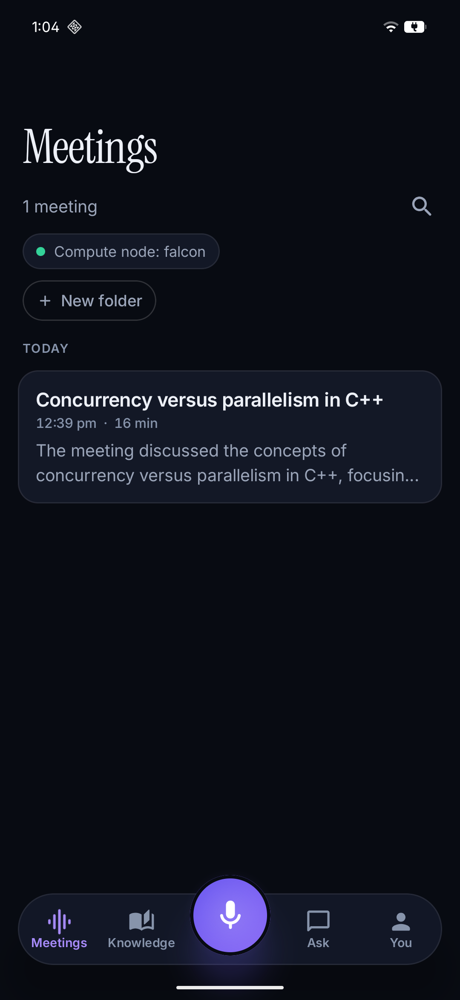
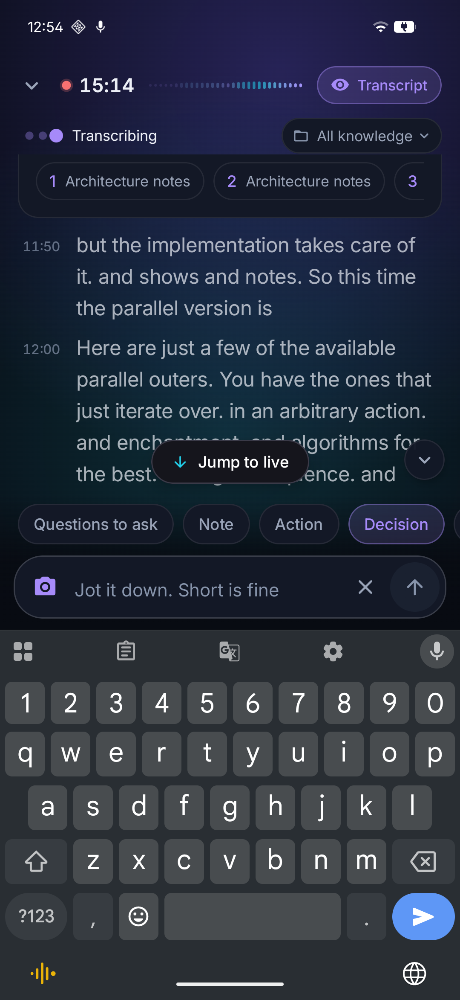
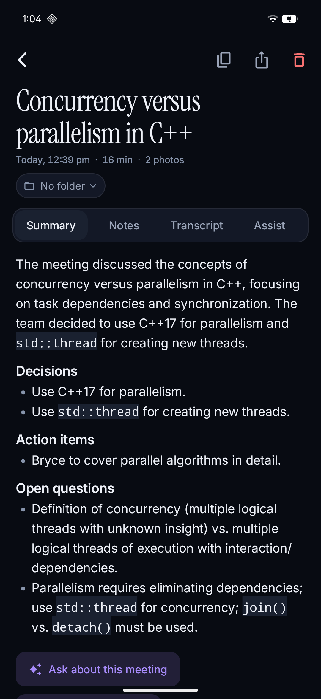
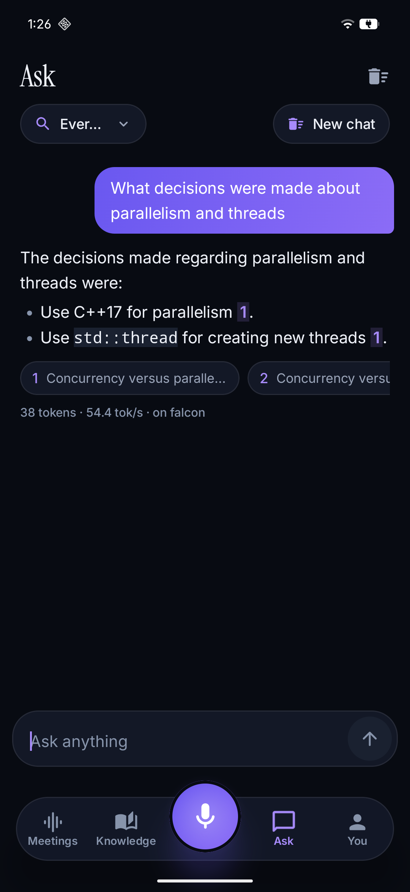
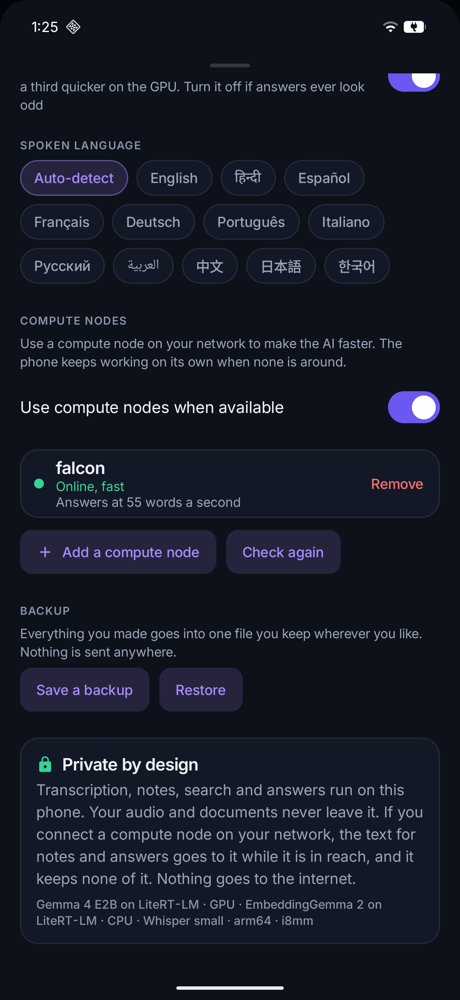
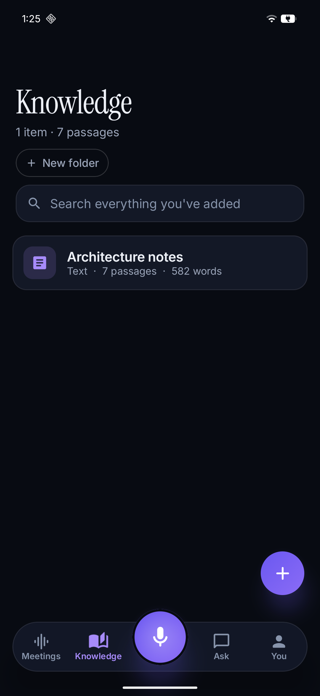
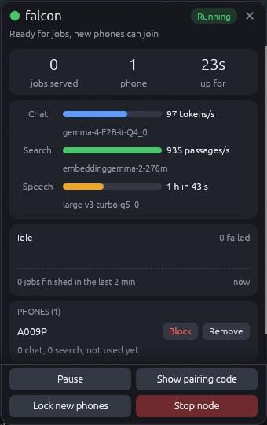
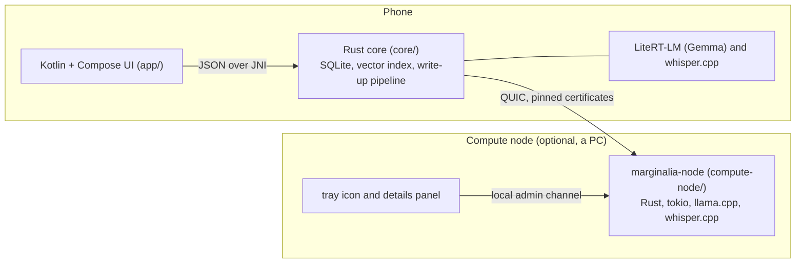

# Marginalia

**Record a meeting, jot as it happens, and get the notes, a summary and answers from your own documents. Everything runs on the phone.**

Optional *compute nodes* on your network make the AI faster while you are near them, and the phone carries on by itself when they are not.

<p align="center">
  
  
  
  
</p>

## Contents

- [Features](#features)
- [How it fits together](#how-it-fits-together)
- [Quick start](#quick-start)
- [Everyday commands](#everyday-commands)
- [Repository map](#repository-map)
- [Tests](#tests)
- [Conventions](#conventions)
- [Documentation](#documentation)
- [Status](#status)
- [License](#license)

## Features

- **Live captions** in many languages, on the phone (whisper.cpp). Nothing is uploaded.
- **Jots**: type a few words while people talk. The AI finds what was said around it and writes it up properly. Four kinds: note, action, decision, question.
- **Notes after the meeting**: a summary and clean notes, also for meetings of two hours. Notes are written once the meeting ends, so recording stays light.
- **Ask** your meetings and documents. Answers carry their sources. Add PDFs, pictures, web pages and text.
- **Photos** of a whiteboard are read and added to the meeting.
- **Speaker separation** after the meeting, with rename and merge. Tap a transcript line to hear it.
- **Better transcripts**: the small model on the phone gives instant captions. After the meeting a compute node listens to the kept
  recording again with a large Whisper model (about 60 to 100 times faster than real time on a GPU). The corrected transcript replaces
  the live one before the notes are written. It is also a button on the Review screen, and an optional switch corrects the captions
  while recording, a few seconds behind.
- **Compute nodes** (optional): a small daemon on a PC does the heavy AI work for the phone. It is found automatically on the Wi-Fi and
  connected with one tap. Notes, answers and search run about six times faster. If a node is lost in the middle of an answer, another
  node or the phone finishes it.
- **Private by design**: no accounts, no cloud, no analytics. Nodes keep nothing and show only counts.

<p align="center">
  
  
  
</p>

<p align="center">
  
</p>

## How it fits together



Every AI job is offered to the compute nodes first, ranked by expected wait, and runs on the phone only when no node can take it.
A job that fails moves to the next node and an answer cut off halfway carries on from the words already shown.
[docs/ARCHITECTURE.md](docs/ARCHITECTURE.md) has the diagrams and the full story.

| Part | Technology | Folder |
| --- | --- | --- |
| App and screens | Kotlin, Jetpack Compose | `app/` |
| Meetings, notes, search, chat logic | Rust, SQLite with FTS5, a vector index | `core/` |
| AI on the phone | Gemma 4 E2B and EmbeddingGemma 2 on Google LiteRT-LM (GPU first), whisper.cpp for speech, sherpa-onnx for speakers | `app/`, `core/`, `vendor/` |
| Wire protocol and trust | Rust, QUIC (quinn), pinned certificates, pairing codes | `compute-node/proto/` |
| Compute node | Rust, tokio, llama.cpp with CUDA or Vulkan | `compute-node/node/` |
| Tray icon | Rust, `ksni` on Linux, `tray-icon` on Windows, `egui` details panel | `compute-node/tray/` |

## Quick start

### The phone app

You need the Android SDK and NDK, Rust with the Android targets, `cargo-ndk` and a phone with USB debugging (Android 14 or newer,
8 GB of memory recommended). The models are not in the repository, [docs/DEVELOPMENT.md](docs/DEVELOPMENT.md) names the three files and `scripts/stage-models.sh` says where it looks for each.

```bash
scripts/fetch-sherpa.sh        # speaker separation library, fetched once
scripts/build-native.sh arm64  # Rust core for the phone
scripts/stage-models.sh        # link the models so Gradle can embed them
./gradlew assembleRelease      # about 3.2 GB with the models inside
```

For daily work build a small debug APK and push the models over USB instead:

```bash
export ANDROID_SERIAL=<your phone>   # needed when more than one device is attached
./gradlew assembleDebug -Pmarginalia.embedModels=false
scripts/push-models.sh
```

### A compute node on Linux

You need Rust, CMake and a C++ toolchain. For an NVIDIA card also the CUDA toolkit.

```bash
compute-node/build.sh                      # CUDA build, or add --cpu-only
target/release/marginalia-node models download
compute-node/packaging/install-linux.sh    # user service and tray icon at login
```

Then check it:

```bash
marginalia-node status     # what the node serves and which phones are paired
marginalia-node stats      # jobs, speed, errors (counts only, never content)
```

### A compute node on Windows

Run `compute-node\windows\setup.ps1` in PowerShell. It needs no bash. See [docs/WINDOWS-PLAN.md](docs/WINDOWS-PLAN.md).

### Connect the phone

Open the app, then **Settings, Compute nodes** (or the banner on the main screen) and tap **Connect**. That is all.
Use `marginalia-node lock` if you want to approve every new phone yourself, or `marginalia-node pair` for a one-time code.

## Everyday commands

| Task | Command |
| --- | --- |
| Run the node in the foreground | `target/release/marginalia-node run` |
| Run on the processor only | `target/release/marginalia-node run --cpu` |
| Build with Vulkan (AMD, Intel) | `cargo build --release -p marginalia-node --features vulkan` |
| Build the tray icon | `cargo build --release -p marginalia-node-tray` |
| Show or fetch model files | `marginalia-node models list` and `marginalia-node models download` |
| Pause or resume new jobs | `marginalia-node pause` and `marginalia-node resume` |
| Let a waiting phone in | `marginalia-node approve` |
| Block or forget a phone | `marginalia-node block <id or name>` and `marginalia-node revoke <id or name>` |
| Try every job type like a phone would | `marginalia-node probe <address>` |
| Service log (Linux) | `journalctl --user -u marginalia-node -f` |

`marginalia-node --help` lists everything. The node listens on UDP 47615 and its local admin channel on TCP 127.0.0.1:47616.
It keeps its identity and paired phones in `~/.config/marginalia-node` and looks for models in `~/.local/share/marginalia/models`.
Set `HF_TOKEN` if a Hugging Face repository asks for a login. The token is never printed or stored.

## Repository map

```
app/            Android app (Kotlin, Jetpack Compose)
core/           Rust core for the phone (JNI library), whisper.cpp and RAG
compute-node/
  proto/        wire protocol, certificates, pairing, framing
  node/         the daemon
  tray/         tray icon and details panel
  packaging/    Linux service files and install script, Docker file for a processor build
  windows/      PowerShell setup, build, status and uninstall scripts
  vendor/       patched llama.cpp bindings
scripts/        build and device helpers for the app (bash)
vendor/         ggml and whisper.cpp used by core/
docs/           architecture, development, audit notes, plans, screenshots
```

The Cargo workspace root is the repository root, so `cargo build` and `cargo test` there cover the protocol and the node.
The phone core is built for Android by `scripts/build-native.sh`.

## Tests

```bash
cargo test -p marginalia-proto          # pairing, pinning, man in the middle, framing
cargo test -p marginalia-node-tray      # tray icon logic
(cd core && cargo test --lib)           # phone core
./gradlew :app:testDebugUnitTest        # Kotlin unit tests
```

Measurements on a real phone and the bugs found are in [docs/AUDIT.md](docs/AUDIT.md).

## Conventions

- **Commit messages** look like `[area] short subject`, then a short body saying why. Areas in use: `repo`, `app`, `core`, `compute-node`.
- **User-visible text** (app, node, tray, scripts) uses plain wording with no semicolons and no em dashes.
  The chat model is "the AI" and the feature is always called "compute node".
- **Nothing private is committed**: no models, no databases, no tokens. `.gitignore` covers `*.gguf`, `*.litertlm`, `*.bin`, `*.sqlite3*` and `*.log`.
- **Nodes are stateless**: never write job content to disk or to a log on a node.
- **Every feature must work on the phone alone.** A compute node only makes it faster.

## Documentation

| File | What is in it |
| --- | --- |
| [docs/ARCHITECTURE.md](docs/ARCHITECTURE.md) | Pieces, job routing, failover, diagrams |
| [docs/DEVELOPMENT.md](docs/DEVELOPMENT.md) | Building the app and the node, debug intents, conventions |
| [docs/AUDIT.md](docs/AUDIT.md) | Measurements and bugs found on a real phone |
| [docs/WINDOWS-PLAN.md](docs/WINDOWS-PLAN.md) | Start here when working on Windows |
| [compute-node/README.md](compute-node/README.md) | Using and running a node |
| [compute-node/DESIGN.md](compute-node/DESIGN.md) | Protocol and the planned cluster of nodes |
| [compute-node/STATUS.md](compute-node/STATUS.md) | What is checked, what is not, next steps |

## Status

Working and tested on an Android phone and Ubuntu: everything above. The compute node on Windows and the tray icon on Windows are written
but not yet verified (see [compute-node/STATUS.md](compute-node/STATUS.md)). Planned: nodes that find and share work with each other,
speech to text on nodes as one open stream.

## License

MIT, see [LICENSE](LICENSE). Third-party code under `vendor/` and `compute-node/vendor/` keeps its own licenses
(llama.cpp, whisper.cpp and ggml are MIT, sherpa-onnx is Apache-2.0).
