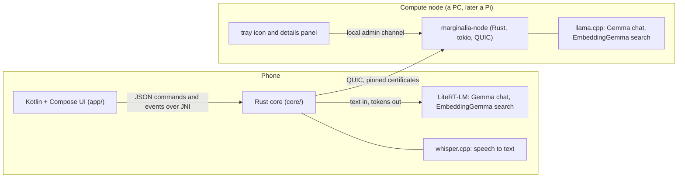
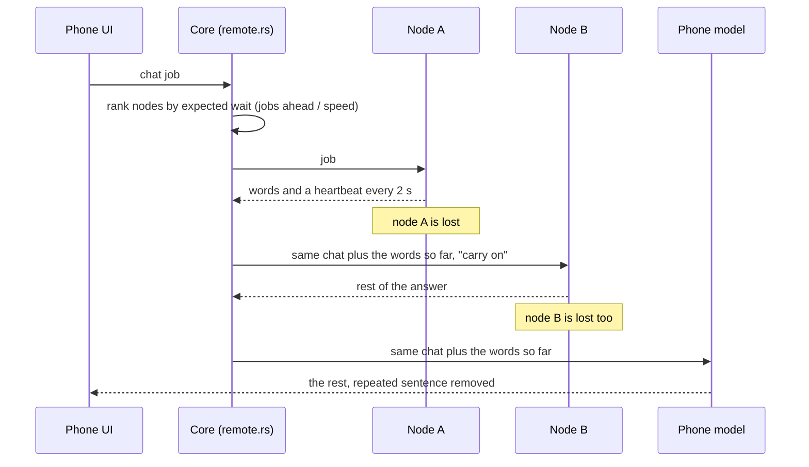
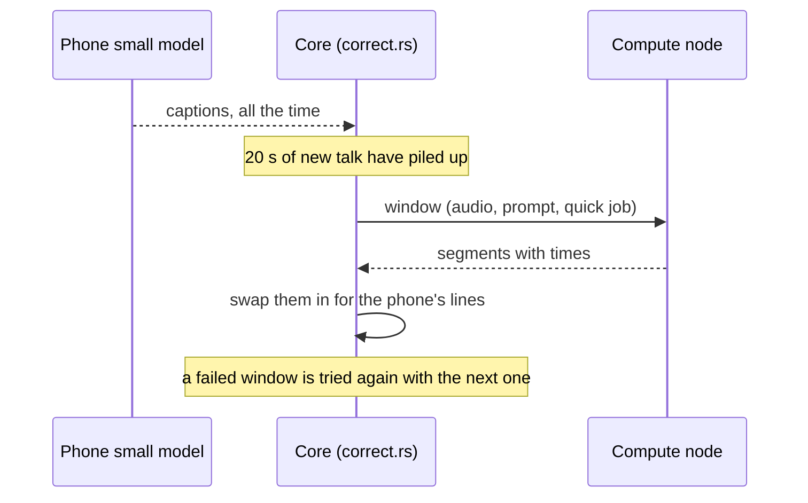

# Architecture

Marginalia is a phone app that listens to a meeting, writes the notes, and answers questions from the people's own
documents. Everything can run on the phone. Optional **compute nodes** on the same network make the heavy AI work faster.

## The pieces

| Part | Where | What it does |
| --- | --- | --- |
| Screens, gestures, notifications, audio capture | `app/` | Kotlin and Jetpack Compose. Talks to the core through `Backend` (JSON over JNI). Runs the two LiteRT-LM models and the speaker separation (sherpa-onnx). |
| Meetings, notes, search, chat | `core/` | Rust. SQLite with FTS5, vector index, the meeting write-up pipeline, living jots, the client for compute nodes (`remote.rs`). |
| Speech to text | `core/src/engine/whisper.rs`, `vendor/whisper.cpp` | whisper.cpp small model, 8-bit, on the phone's CPU. |
| Wire protocol and trust | `compute-node/proto/` | Messages, certificates and pinning, pairing, framing, the client helpers. |
| The node daemon | `compute-node/node/` | Serves chat and search jobs with llama.cpp. Keeps nothing about a job. |
| Tray icon | `compute-node/tray/` | Top bar (Linux) or system tray (Windows) icon with a small details panel. |

## How a job is routed

The phone core owns two handles, one for chat and one for search. Each one first offers the job to the compute
nodes and only then runs it on the phone.

- **Silence for 6 seconds** from a node means it is lost. A network drop is detected at once from Android's connectivity callback.
- **A node that gets slow is replaced too.** Below 4 words a second over 5 seconds, the answer moves on (words kept) and that node is left alone for 2 minutes. The phone ranks nodes by the lower of the speed the node reports and the speed it really got. A node folds the speed of real jobs into what it reports and measures itself again every 5 minutes while idle, so a busy or hot graphics card shows up.
- **Words already shown stay shown.** The next node, or the phone, is asked to carry on from them. A seam filter drops a repeated sentence.
- **The phone's own model runs one job at a time.** Jobs on nodes run side by side, so every node can be busy. The meeting write-up writes its parts on several nodes at once.
- **Search vectors** from a node and from the phone agree (cosine 0.98 to 0.99), so documents indexed in either place search together.
- **Transcription of a recording** is a job too. A node that has the speech model (`ggml-large-v3-turbo-q5_0`, advertised as `transcribe` and `transcribe_x`, the times faster than real time) takes raw 16 kHz PCM in 1 MB frames on the request stream and streams back `Segment`s with times as whisper finishes them, plus `Progress` and a heartbeat every 2 seconds. It handles up to 3 hours, one recording at a time, and stops at once if the phone disconnects. It is about 100 times faster than real time on an RTX 4060. Nothing is stored. See `compute-node/README.md`.
- **Live correction** (setting `live_correction`, off by default) uses the same job while recording. It is described in the next section.

## Live correction

While recording, the phone's small model writes captions at once. With the setting `live_correction` on (off by default) and a
compute node that has the large speech model, the core also listens again in short windows and swaps the node's text in for its
own a few seconds later. The captions never wait for the node. If a window fails, the phone's text stays and the window is tried
again as part of the next one. The code is in [`core/src/session/correct.rs`](../core/src/session/correct.rs).

**The window rule.** The core keeps the last few minutes of the live 16 kHz audio. Every 20 seconds of new talk (choices 20, 30, 45
and 60 in `live_correction_window_s`, default 20) it cuts a window that starts where the last corrected segment started and stops
4 seconds before now. The node hears that segment again and returns a longer, better one in its place. A window is sent as its own
`Transcribe` job with `Interactive` priority, the real `total_ms` and the last 200 characters of the earlier text as `prompt`.
It is never longer than the node's `Capabilities.window_max_s` (120 when not stated) and never shorter than 15 seconds. Only one
window is out at a time, and the next one covers any gap. Segments that start at the window start (less 0.3 s) or later, reach past
the corrected text and end before the window does replace the live lines and the stored segments for that stretch. The screen hears
about it with a `lines_replace` event, and lines carry a stable `id` so the list keeps its place. A failed, empty or implausibly short
answer changes nothing.

The first rule started a window 5 seconds before the corrected text ended. The node then began a segment in the middle of speech at
the window start, that segment was rejected as unsafe and the new words in it were lost, window after window. Starting at the
beginning of a segment loses nothing.

**Why windows and not one open audio stream.** This was decided against.

- Each window is its own request on the existing connection, so failover to another node or to the phone's own captions is free.
  A failed window is simply tried again and the phone's small model keeps writing captions the whole time.
- Setup per window is negligible. A node answers a 44 second window in about 0.42 s (0.64 s while Gemma writes on the same card, 2 to
  20 s on a node with a processor only).
- A stream would need state per stream on a node that is meant to keep nothing.

**What it gets.** The phone's rules were simulated against the real node on stitched FLEURS speech (140 to 190 s per language).
Share of the reference words that ended up corrected:

| Language | Old rule (20 s windows) | 10 s windows | 20 s windows (default) | 30 s windows |
| --- | --- | --- | --- | --- |
| Spanish | 38% | 82% | 98% | 98% |
| German | 44% | 64% | 77% | 73% |
| French | 36% | 81% | 87% | 86% |

The precision of the corrected text stays between 92% and 99%. The corrected text runs about 12 s behind the speech with 20 s
windows (8 s with 10 s windows, 15 to 17 s with 30 s windows). The phone's own captions stay instant. A 10 s choice was not added
because recall dropped for German. On a real phone (a talk played into the microphone) the first correction arrives
about 36 s into a recording with 30 s windows. The live screen says what is happening ("will check every 20 s", "is checking 00:25
to 00:55", "checked up to 00:55") and the fixed lines glow for 4 s.

## Trust and privacy

- Every device makes itself a self-signed certificate. A phone saves the fingerprint of each node it trusts, and a node saves the fingerprint of each phone it lets in. Connections are mutually pinned QUIC (TLS 1.3).
- The normal way in: the phone finds a node by itself, asks the person "Connect to this compute node?", and the node lets the phone in. A node can be locked (new phones must be allowed by a trusted phone or at the node), phones can be blocked, and pairing with a one-time code stays as the strict route. The code is stretched with scrypt and bound to the TLS session, so a device in the middle cannot pass it on.
- A node stores only its identity and its list of phones. Job text, answers and vectors live in memory for the length of the request. Its statistics are counts and timings, never content.
- Text of notes, questions and passages goes to nodes the person trusted. Audio goes only for "Improve transcript" (a node with a large speech model listens to the kept recording again, after a meeting or from the Review screen) and, when the person switches it on, for live correction (short windows of the live audio while recording), which the node transcribes and forgets. The setting `improve_transcript` turns the automatic run off. The live transcript is replaced only when the node returns a plausible one, and a node that drops out partway hands the rest to the next node or leaves the live text.

## The phone side in more detail

- **Recording.** `Recorder` captures audio, the core's VAD cuts it into snippets, whisper.cpp transcribes them. Long meetings are condensed part by part while recording so the write-up can be built from those parts.
- **Write-up after the meeting.** Models stay loaded until the write-up finishes and are then unloaded. A foreground service (`WorkService`) keeps the process alive and a persisted job restarts it if Android ends it. Unfinished meetings are picked up again, and parts already written are reused.
- **Jots.** A short note typed during a meeting is turned into a proper line using the transcript around it, and can be reworded once when later talk adds a detail.
- **Search.** Hybrid retrieval: dense vectors with a Matryoshka prefilter, FTS5 BM25, reciprocal rank fusion, MMR, neighbour expansion. Every answer carries citations.
