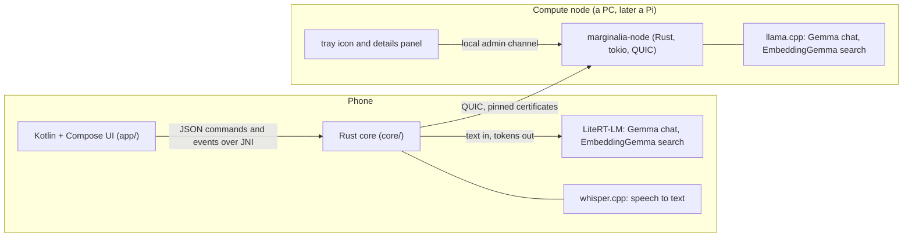
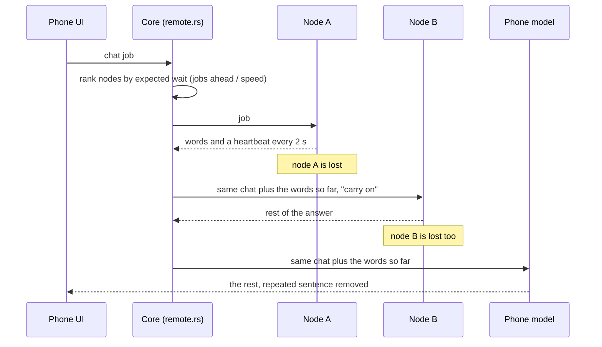

# Architecture

Marginalia is a phone app that listens to a meeting, writes the notes, and answers questions from the people's own
documents. Everything can run on the phone. Optional **compute nodes** on the same network make the heavy AI work faster.

## The pieces

| Part | Where | What it does |
| --- | --- | --- |
| Screens, gestures, notifications, audio capture | `app/` | Kotlin and Jetpack Compose. Talks to the core through `Backend` (JSON over JNI). Runs the two LiteRT-LM models and the speaker separation (sherpa-onnx). |
| Meetings, notes, search, chat | `core/` | Rust. SQLite with FTS5, vector index, the meeting write-up pipeline, living jots, the client for compute nodes (`remote.rs`). |
| Speech to text | `core/src/engine/whisper.rs`, `vendor/whisper.cpp` | whisper.cpp small model, 8-bit, on the phone's CPU. |
| Wire protocol and trust | `compute-node/proto/` | Messages, certificates and pinning, pairing, framing, the client helpers. |
| The node daemon | `compute-node/node/` | Serves chat and search jobs with llama.cpp. Keeps nothing about a job. |
| Tray icon | `compute-node/tray/` | Top bar (Linux) or system tray (Windows) icon with a small details panel. |

## How a job is routed

The phone core owns two handles, one for chat and one for search. Each one first offers the job to the compute
nodes and only then runs it on the phone.

- **Silence for 6 seconds** from a node means it is lost. A network drop is detected at once from Android's connectivity callback.
- **Words already shown stay shown.** The next node, or the phone, is asked to carry on from them. A seam filter drops a repeated sentence.
- **The phone's own model runs one job at a time.** Jobs on nodes run side by side, so every node can be busy. The meeting write-up writes its parts on several nodes at once.
- **Search vectors** from a node and from the phone agree (cosine 0.98 to 0.99), so documents indexed in either place search together.

## Trust and privacy

- Every device makes itself a self-signed certificate. A phone saves the fingerprint of each node it trusts, and a node saves the fingerprint of each phone it lets in. Connections are mutually pinned QUIC (TLS 1.3).
- The normal way in: the phone finds a node by itself, asks the person "Trust this compute node?", and the node lets the phone in. A node can be locked (new phones must be allowed by a trusted phone or at the node), phones can be blocked, and pairing with a one-time code stays as the strict route. The code is stretched with scrypt and bound to the TLS session, so a device in the middle cannot pass it on.
- A node stores only its identity and its list of phones. Job text, answers and vectors live in memory for the length of the request. Its statistics are counts and timings, never content.
- The phone never sends audio to a node. Only the text of notes, questions and passages goes, and only to nodes the person trusted.

## The phone side in more detail

- **Recording.** `Recorder` captures audio, the core's VAD cuts it into snippets, whisper.cpp transcribes them. Long meetings are condensed part by part while recording so the write-up can be built from those parts.
- **Write-up after the meeting.** Models stay loaded until the write-up finishes and are then unloaded. A foreground service (`WorkService`) keeps the process alive and a persisted job restarts it if Android ends it. Unfinished meetings are picked up again, and parts already written are reused.
- **Jots.** A short note typed during a meeting is turned into a proper line using the transcript around it, and can be reworded once when later talk adds a detail.
- **Search.** Hybrid retrieval: dense vectors with a Matryoshka prefilter, FTS5 BM25, reciprocal rank fusion, MMR, neighbour expansion. Every answer carries citations.

## Measurements

See [AUDIT.md](AUDIT.md) for what was measured on a real phone (speed, memory, battery temperature, bugs found and fixed).
